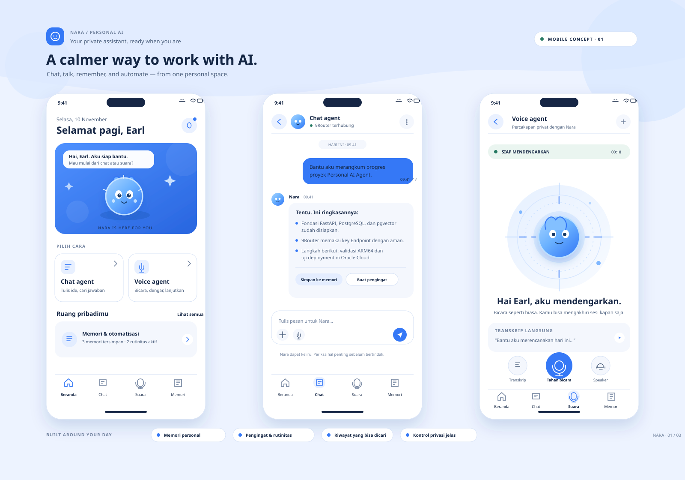

# Personal AI Agent

Asisten AI privat untuk satu pengguna. Aplikasi berjalan dengan FastAPI, PostgreSQL + pgvector, 9Router, dan antarmuka chat web. Compose menyertakan layanan 9Router dan mendukung image ARM64; target deployment adalah Oracle Cloud Ubuntu 24.04 ARM64, 2 OCPU, RAM 12 GB.

## Fitur

- Login kata sandi dengan cookie sesi aman, pembatasan percobaan login, dan header keamanan.
- Chat tersimpan di PostgreSQL, daftar percakapan dapat dibuka dan dihapus.
- Memori tersimpan menggunakan embedding 9Router dan pencarian cosine pgvector; bila layanan embedding sementara gagal, aplikasi mengambil memori terbaru.
- Antarmuka mobile-first berbahasa Indonesia: beranda Nara, chat tersimpan, voice agent, memori, pengingat berulang, serta pengaturan privasi.
- Simpan balasan Nara secara eksplisit ke memori dari chat; pengguna tetap dapat menghapus memori kapan saja.
- PWA yang dapat dipasang; cache lokal hanya menyimpan shell statis, bukan chat atau respons API.
- Voice agent memakai transkrip suara browser yang tersedia, mengirim teks melalui API chat, dan membacakan jawaban bila browser mendukung.
- Pencarian lintas judul dan isi chat, pengingat harian/mingguan, notifikasi browser saat aplikasi terbuka, serta ekspor data JSON.
- Konten pesan dirender sebagai teks, bukan HTML; navigasi keyboard, target sentuh besar, status dinamis, dan reduced motion disediakan.
- Backup PostgreSQL otomatis harian, terenkripsi, dengan retensi yang dapat diatur.
- Deployment lewat Docker Compose, reverse proxy Caddy, dan HTTPS otomatis.

## Aplikasi mobile web Nara

Antarmuka **Nara Personal AI** mengikuti rancangan FigCraft: beranda dengan companion, chat agent, dan voice agent. Bagian lain menyediakan memori yang dapat dihapus, pencarian riwayat, pengingat sekali/hari/mingguan, ekspor data, dan kontrol perangkat. Tampilan menyesuaikan layar ponsel dan desktop; pada browser yang mendukung, aplikasi dapat dipasang ke layar utama.

- [Buka file native FigCraft](design/nara-personal-ai-mobile.figcraft)
- [Lihat rancangan SVG](design/nara-personal-ai-mobile.svg)



### Voice dan notifikasi

Transkrip suara memakai `SpeechRecognition`/`webkitSpeechRecognition` bila tersedia di browser. Pengguna dapat memeriksa atau mengedit transkrip sebelum mengirimnya. Browser atau vendor pengenal suara dapat memproses audio sesuai kebijakannya; aplikasi mengirim transkrip teks ke 9Router. Pembacaan jawaban memakai speech synthesis browser.

Pengingat tersimpan di PostgreSQL dan notifikasi browser hanya dipicu ketika aplikasi terbuka. Ini bukan push notification atau scheduler server; untuk menerima pengingat saat semua tab tertutup, integrasi push dan worker server masih perlu dikembangkan.

Browser tanpa dukungan notifikasi tetap dapat melihat jadwal ketika membuka halaman Pengingat. Selesaikan pengingat rutin untuk menjadwalkan kejadian berikutnya.

Gunakan HTTPS untuk izin mikrofon dan pemasangan PWA. Di Chrome/Edge pilih **Install app**; di iOS Safari gunakan **Bagikan → Tambah ke Layar Utama**. Browser tanpa Web Speech API tetap dapat memakai chat dan mengetik transkrip voice secara manual.

## Jalankan di server

Perlu Docker Engine dengan Docker Compose v2, OpenSSL, dan `age` (`sudo apt install age`). Dari Ubuntu, clone repo, lalu jalankan:

```bash
cp .env.example .env
bash scripts/start-9router-bootstrap.sh
```

Script bootstrap membuat `NINEROUTER_API_KEY_SECRET` acak di `.env` dengan izin file terbatas. Nilai tetap ini dipakai selama bootstrap dan saat service Compose berjalan; jangan dihapus atau diganti setelah API key diterbitkan karena 9Router memakainya untuk memvalidasi API key lokal.

Masuk ke dashboard 9Router yang tersedia di loopback port 20128, ubah kata sandi awal `123456`, sambungkan provider AI, lalu buat/salin API key untuk **Endpoint 9Router** dari dashboard beserta nama model chat dan embedding. Masukkan key Endpoint itu saat script meminta. Jangan masukkan key milik provider (misalnya OpenAI/Anthropic) pada aplikasi ini; key provider disimpan di dashboard 9Router. Aplikasi mengirim key Endpoint melalui header `Authorization: Bearer ...` ke `http://ninerouter:20128/v1`. Hapus container bootstrap setelah selesai; data router tetap ada di volume Docker:

```bash
docker rm -f personal-ai-ninerouter-bootstrap
```

Script berikut meminta nilai tersebut bersama kata sandi aplikasi, lalu membuat secret acak sesi, PostgreSQL, dan pasangan kunci `age` untuk backup:

```bash
bash scripts/init-secrets.sh
```

Simpan salinan aman dari `./.secrets/backup_age_key` dan `.env` di luar server; tanpa kunci privat age, backup terenkripsi tidak dapat dipulihkan, dan `.env` berisi secret validasi API key 9Router.

Jalankan layanan:

```bash
docker compose up -d --build
```

API key Endpoint dan model 9Router sudah disimpan oleh script penyiapan. Jika Anda memutar key Endpoint, perbarui `.secrets/ninerouter_api_key`; jika mengubah model, perbarui nilai model di `.env`. Restart aplikasi sesudah mengubah konfigurasi:

```bash
docker compose restart app
```

Aplikasi lokal ada di `http://127.0.0.1:8000`. Jika `COOKIE_SECURE=true`, akses lewat HTTPS atau gunakan tunnel HTTPS; untuk uji lokal sementara, atur `COOKIE_SECURE=false` di `.env`.

## HTTPS dan backup

Untuk domain yang DNS-nya mengarah ke server, atur `DOMAIN=ai.example.com` di `.env`, buka TCP 80/443 ke server, lalu mulai Caddy:

```bash
docker compose --profile tls up -d --build
```

Aktifkan backup harian:

```bash
mkdir -p backups
docker compose --profile backup up -d
```

Backup terenkripsi tersimpan di `./backups` sebagai file `.dump.age`. Simpan salinan di lokasi lain dan jaga kunci privat secara terpisah. Pemulihan mengganti data aktif dan meminta konfirmasi:

```bash
bash scripts/restore.sh backups/personal-ai-YYYYMMDDTHHMMSSZ.dump.age
```

Lihat [panduan Oracle Cloud](docs/deployment-oracle-cloud.md), [arsitektur](docs/architecture.md), [catatan pengembangan berikutnya](docs/next-steps.md), dan [riwayat perubahan](CHANGELOG.md).

## Data dan privasi

Riwayat chat dan memori berada di database PostgreSQL pada volume Docker. Teks pesan dan pertanyaan embeddings dikirim ke 9Router; model chat dan embedding yang dipilih dapat meneruskan data ke provider AI terkait. Jangan menyimpan rahasia yang tidak ingin dikirim ke layanan tersebut. Hapus memori dari sidebar atau percakapan lewat tombol hapus. Instalasi ini dirancang untuk satu pengguna, bukan multi-tenant.

## Pemeriksaan

Jalankan tes konfigurasi setelah Python tersedia dan `pip install -r requirements-dev.txt`: `python -m pytest -q`. Periksa konfigurasi Compose: `docker compose config`. Buat image untuk ARM64: `docker buildx build --platform linux/arm64 -t personal-ai:arm64 .`. Lihat status dan log dengan `docker compose ps` dan `docker compose logs app db ninerouter`.
